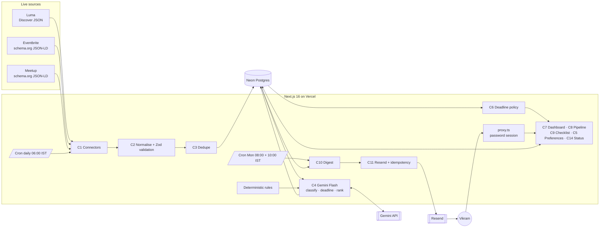

# Event Scout — Components Map

**Event Scout** — AI-powered event intelligence for business development.
*Find the right rooms. Never miss the opportunity.*

MESA School of Business · Cohort C4 · AI and its Applications — Final Project
Problem statement: **Industry Event Scout**

**Live app:** https://event-scout-five.vercel.app · **Repository:** https://github.com/vyombhatnagar-lgtm/event-scout

> **Status legend** — ✅ Implemented and verified (test or live production run) · 🟨 Implemented, partially verified · ⬜ Planned
>
> Last updated: 12 Oct 2026 — deployed to Vercel with Neon, Gemini Flash and Resend. Nothing is ✅ unless exercised by a test or a live run — see §7.

---

## 1. Requirement traceability

| # | Requirement | Type | Delivered by | Status |
|---|---|---|---|---|
| R1 | Live external event data (no fabricated records) | **Mandatory** | C1, C2 | ✅ 110 live events stored in production (12 Oct) |
| R2 | Multi-source discovery | **Mandatory** | C1 — Luma, Eventbrite, Meetup | ✅ all three succeeded in production (30 / 55 / 36) |
| R3 | Configurable categories and cities, no code change | **Mandatory** | C5 (DB-stored preferences + Settings page) | ✅ saved via the live API and persisted |
| R4 | AI relevance ranking with **Gemini Flash** | **Mandatory** | C4 | 🟨 live Gemini Flash classification verified (25 events); full ranking limited by free-tier quota (20 req/day/model) — see §8 |
| R5 | Events covering the next 30 days | **Mandatory** | `discoveryWindow()` | ✅ |
| R6 | Registration deadline detection | **Mandatory** | C1 (source-stated), C4 (text extraction w/ evidence) | ✅ logic tested · live sources stated no deadlines on 12 Oct |
| R7 | Clear warning when deadline < 7 days | **Mandatory** | C6, C7, C10 | ✅ boundary tests |
| R8 | Clean, scannable weekly digest | **Mandatory** | C10 | ✅ delivered to inbox (12 Oct) |
| R9 | Delivered every Monday morning (automated) | **Mandatory** | Vercel Cron → C10 → C11 | ✅ crons registered; scheduled endpoint sent once and blocked the repeat |
| R10 | Deployed on Vercel, public URL | **Mandatory** | §6 | ✅ https://event-scout-five.vercel.app |
| R11 | GitHub repository + Components Map | **Mandatory** | this file, README | ✅ |
| E1 | Dashboard / command centre | Enhancement | C7 | ✅ live with real data |
| E2 | Duplicate detection across sources | Enhancement | C3 | ✅ unit + live |
| E3 | Event pipeline | Enhancement | C8 | 🟨 implemented; manual UI check pending |
| E4 | Weekly action checklist | Enhancement | C9 | ✅ tasks generated from live events |
| E5 | Google Calendar | Enhancement | C12 | ⬜ Phase 7 |
| E6 | Calendly booking link | Enhancement | C13 | ✅ link saved in live preferences |
| E7 | Observability / system status | Enhancement | C14 | ✅ source runs, job runs and Gemini errors visible on /status |

---|---|---|---|---|
| R1 | Live external event data (no fabricated records) | **Mandatory** | C1, C2 | ✅ connectors verified against live sources · 🟨 persistence needs `DATABASE_URL` |
| R2 | Multi-source discovery | **Mandatory** | C1 — Luma, Eventbrite, Meetup | ✅ all three returned live events |
| R3 | Configurable categories and cities, no code change | **Mandatory** | C5 (DB-stored preferences + Settings page) | 🟨 logic tested · persistence needs DB |
| R4 | AI relevance ranking with **Gemini Flash** | **Mandatory** | C4 | 🟨 rules + guards tested · live Gemini call needs `GEMINI_API_KEY` |
| R5 | Events covering the next 30 days | **Mandatory** | C1 window filter, `discoveryWindow()` | ✅ |
| R6 | Registration deadline detection | **Mandatory** | C1 (source-stated), C4 (text extraction w/ evidence) | ✅ logic tested · 🟨 AI extraction needs key |
| R7 | Clear warning when deadline < 7 days | **Mandatory** | C6, C7, C10 | ✅ boundary tests |
| R8 | Clean, scannable weekly digest | **Mandatory** | C10 | 🟨 template built · needs DB + data |
| R9 | Delivered every Monday morning (automated) | **Mandatory** | Vercel Cron → C10 → C11 | 🟨 needs deploy + `RESEND_API_KEY` |
| R10 | Deployed on Vercel, public URL | **Mandatory** | §6 | ⬜ |
| R11 | GitHub repository + Components Map | **Mandatory** | this file, README | 🟨 repo not yet pushed |
| E1 | Dashboard / command centre | Enhancement | C7 | 🟨 builds; needs DB to show data |
| E2 | Duplicate detection across sources | Enhancement | C3 | ✅ unit + live |
| E3 | Event pipeline | Enhancement | C8 | 🟨 |
| E4 | Weekly action checklist | Enhancement | C9 | 🟨 |
| E5 | Google Calendar | Enhancement | C12 | ⬜ Phase 7 |
| E6 | Calendly booking link | Enhancement | C13 | 🟨 configurable link implemented |
| E7 | Observability / system status | Enhancement | C14 | 🟨 |

---

## 2. Architecture

Flow: connectors fetch → records validated and normalised (unknowns stay null) → duplicates merged with every source reference kept → stored → Gemini Flash classifies, summarises and extracts explicit deadlines → relevance = deterministic rules blended with Gemini, per user preferences → the dashboard and the Monday digest read the same ranked rows.

---

## 3. Components

### C1 · Event Discovery Engine — **Mandatory**
| Connector | Method | Deadline data | Notes |
|---|---|---|---|
| Luma | Public Discover listing JSON by city + public event detail | `ticket_types[].valid_end_at` when every visible ticket type states one | Undocumented endpoint: all fields optional; shape changes surface as run errors |
| Eventbrite | schema.org Event JSON-LD on public city/category pages | Not published in listings → unknown | Public search API was retired in 2020. Paced at 1 request / 2 s, one 429 retry. Out-of-country promoted listings filtered |
| Meetup | schema.org Event JSON-LD on public "find" pages (Career & Business) | Not published → unknown | Cancelled events skipped |

Each run writes a `source_runs` row: source, start/finish, status (success / partial / failed), retrieved, accepted, errors. One failing source never blocks the others. iSPIRT was evaluated and excluded (its feed is blog posts, not events).
**Code:** `src/lib/discovery/connectors/*`, `pipeline.ts`, `/api/cron/discover`

### C2 · Normalisation — **Mandatory**
Zod schema `CandidateEventSchema` (`src/types/event.ts`): http(s) URLs only, title 3–300 chars, end ≥ start, text cleaned of HTML/entities. Invalid records are rejected with a logged reason — never patched with guesses. Date-only sources are stored as all-day (`all_day = true`) at local midnight rather than inventing a time.

### C3 · Duplicate Detection
Order: (1) same source + source id, (2) same canonical URL, (3) dedupe key = normalised title + **IST calendar date** + city. Title similarity alone never merges. Merged events keep every `event_sources` row. Most complete record wins as primary.
**Code:** `src/lib/discovery/deduplicate.ts`, `normalise.ts`

### C4 · Gemini Flash Intelligence — **Mandatory**
- Models: `GEMINI_MODEL`, a comma-separated list of Flash models (default `gemini-3.8-flash, gemini-3.6-flash, gemini-3.5-flash`). Non-Flash ids are refused. When one model is out of quota (429) or overloaded (503) the next Flash model is used. SDK: `@google/genai`, server-only.
- Three narrow, batched tasks, each with a JSON schema (`responseJsonSchema`) **and** Zod re-validation, `temperature 0`:
  1. **Classification + summary** (`classification.ts`) — fixed category enum, audience only if stated.
  2. **Deadline extraction** (`deadlines.ts`) — only for events with no source deadline and text that plausibly contains one; result accepted only if the verbatim evidence quote is found in the source text and the date is before the event (`evidence.ts`).
  3. **Relevance** (`ranking.ts`) — 0–100 with a one-sentence reason citing event facts.
- **Hybrid score** (`src/lib/ranking/rules.ts`): `final = 0.35 × rules + 0.65 × Gemini`; rules = location 35 + topic 35 + format 15 + timing 15. Hard mismatches (in-person outside target cities, unwanted online) are capped at 35 so AI cannot override preferences. If Gemini is unavailable the rule score is used and the event is labelled "AI pending".
- Reliability: calls paced to 4/minute (free tier allows 5), batches of 15 (classification) / 30 (ranking), 429 never retried on the same model, 503 retried with back-off, malformed/invalid output rejected, failures recorded on the event and in `job_runs`. Events not yet assessed are labelled "Rules only · AI pending" in the UI.

### C5 · User Preferences — **Mandatory**
Categories, cities, topics, formats, minimum fit score, digest recipient, digest on/off, Calendly link. Stored in `user_preferences`; labelled "default" until first save. Saving triggers immediate re-ranking (scores are keyed by a hash of the preference fields).

### C6 · Deadline Intelligence — **Mandatory**
Stored separately from event dates, never inferred from them. Time-zone policy: stored UTC, displayed and bucketed in `Asia/Kolkata`. `urgent` ⇔ 0 < time left < exactly 7 × 24 h; `closed` ⇔ passed; missing ⇒ "Deadline unknown". Conflicting sources → earliest kept, flagged. Passed deadlines never shown as open unless the source currently reports registration open.

### C7 · Dashboard
Weekly figures, top recommended, deadlines < 7 days, actions, upcoming registered events, pipeline counts, source freshness, warnings for default preferences / failed sources / unscored events. Streaming loading skeletons, empty and error states; buttons call real endpoints and report real outcomes.

### C8 · Event Pipeline
`discovered → saved → to_register → registered → attended → follow_up_complete`, set manually (skips allowed). Registration status is never changed automatically.

### C9 · Weekly Checklist
Generated only from real data: register (urgent or "to register"), decide (top new matches), prepare (registered, within 7 days), follow up (attended). Unique per week/kind/event; done-state persists.

### C10 · Weekly Digest — **Mandatory**
Next 30 days; urgent deadlines first, then top 12 by fit; dates, locations, reasons, deadline with origin, registration + source links, open checklist items, dashboard link. HTML + plain text. Preview at `/digest`.

### C11 · Email Delivery — **Mandatory**
Resend. `digest_runs.idempotency_key` is unique: `scheduled:<user>:<week>` (cron) or `manual:<user>:<minute>`. A sent digest is never resent; a failed one may be retried (atomic claim); the same key is passed to Resend's `idempotencyKey` so a timed-out request cannot double-send. Every attempt logged in `notification_logs`. Two Monday crons (08:00, 10:00 IST) give an automatic retry.

### C12 · Google Calendar — Enhancement ⬜ (Phase 7)
Planned: OAuth (`calendar.events` scope), add selected events + deadline reminder, `calendar_links` table, duplicate prevention, revoked-access handling.

### C13 · Calendly — Enhancement 🟨
Configurable `calendly.com` link (validated), surfaced in follow-up tasks, dashboard and digest. No attendee identification is claimed.

### C14 · Observability
`source_runs`, `job_runs`, `digest_runs`, `notification_logs`, per-event `ai_status`. `/status` shows configuration presence (never values), source health with error detail, job history.

### Security
Password-protected app (`APP_PASSWORD`; HMAC-signed httpOnly cookie, constant-time compare) enforced in `src/proxy.ts` for every page and API route; cron routes require `Authorization: Bearer CRON_SECRET`; all inputs Zod-validated; API errors are generic to the browser and detailed in server logs; keys only in env vars; `.env.example` holds placeholders.

---

## 4. Data model (Neon Postgres, Drizzle ORM)

Migration: `db/migrations/0000_init.sql` (generated from `src/lib/db/schema.ts`).

| Table | Purpose | Key constraints |
|---|---|---|
| `users` | Vikram (single-user) | PK |
| `user_preferences` | C5 | PK/FK user; `min_score` 0–100 |
| `events` | Canonical event | unique `dedupe_key`; idx start, deadline, url; end ≥ start |
| `event_sources` | Every source reference | unique (source, source_event_id); FK cascade |
| `event_scores` | Per-user rules/AI/final score + reason | PK (event, user); final 0–100 |
| `saved_events` | Pipeline status | PK (user, event) |
| `checklist_tasks` | C9 | unique (user, week, kind, event) |
| `digest_runs` | Digest sends | unique `idempotency_key` |
| `notification_logs` | Each email attempt | FK digest_run |
| `source_runs` | Connector run stats | idx (source, started) |
| `job_runs` | Cron/manual job history | idx (job, started) |

Change from the original plan: **Neon replaces Supabase**, provisioned through the Vercel Neon integration. Access control is enforced in the app (single owner, server-only DB credentials, optional password) instead of Supabase row-level security.

---

## 5. Configuration

| Variable | Purpose |
|---|---|
| `DATABASE_URL` | Neon connection string |
| `GEMINI_API_KEY`, `GEMINI_MODEL` | Gemini Flash |
| `RESEND_API_KEY`, `DIGEST_FROM_EMAIL`, `DIGEST_RECIPIENT_EMAIL` | Email |
| `CRON_SECRET` | Authorises Vercel Cron |
| `APP_PASSWORD`, `SESSION_SECRET` | App access |
| `APP_URL` | Links in emails (falls back to Vercel's production URL) |

## 6. Schedules (`vercel.json`)

| Job | UTC | IST | Route |
|---|---|---|---|
| Discovery + AI | daily 00:30 | 06:00 | `/api/cron/discover` |
| Digest | Mon 02:30 | Mon 08:00 | `/api/cron/digest` |
| Digest retry (sends only if 08:00 failed) | Mon 04:30 | Mon 10:00 | `/api/cron/digest` |

---

## 7. Testing evidence

`npm test` (unit, 43 tests) and `npm run test:live` (live network, 5 tests). Production checks run against https://event-scout-five.vercel.app on 12 Oct 2026.

| Area | Test | Result |
|---|---|---|
| Discovery | Luma, Eventbrite, Meetup each return real, valid events with https source URLs (local live test: 23 / 45 / 24) | ✅ |
| Discovery | Production cron run: 110 events stored (Luma 30, Eventbrite 55, Meetup 36), 0 source errors, 76 s | ✅ |
| Discovery | Unreachable source fails cleanly, no invented data | ✅ |
| Discovery | Invalid records rejected (bad URL, no title, end < start) | ✅ |
| Dedupe | Cross-site merge; same title on another date/city kept apart; same id/URL merged; IST date key | ✅ |
| Dedupe | Live combined run: 92 listings → 84 events, 4 found on more than one source | ✅ |
| Deadlines | Exactly 7 days → not urgent; 7 days − 1 s → urgent; tomorrow; < 24 h; passed; unknown; conflicting sources | ✅ |
| Time zone | IST date, IST midnight, Monday week start across the UTC boundary | ✅ |
| AI | Live Gemini Flash structured output validated and stored (25 events classified in production) | ✅ |
| AI | Quota (429) and overload (503) handled: events kept pending, rule score used, errors shown on /status | ✅ |
| AI guard | Evidence must appear in text; deadline after event rejected; pre-filter | ✅ |
| Ranking | Relevant > irrelevant; deterministic; city and topic changes move scores; AI cannot beat hard caps | ✅ |
| Preferences | Validation (≥1 city, Calendly-only links); saved through the live API and read back | ✅ |
| Database | Migrations applied automatically on Vercel build; data persists in Neon | ✅ |
| Email | Manual digest delivered via Resend; repeat in the same minute blocked | ✅ |
| Cron | `/api/cron/*` returns 401 without `CRON_SECRET` | ✅ |
| Cron | Scheduled digest endpoint sent this week's digest once; second call "Already sent for this week" | ✅ |
| Cron | Three schedules registered in Vercel (discovery daily, digest Mon 08:00 + 10:00 IST) | ✅ |
| Build | `next build` + `tsc` + ESLint clean | ✅ |
| Deployment | Public URL loads; production integrations work | ✅ |

## 8. Known limitations

- Coverage = Luma + Eventbrite + Meetup for the configured cities. Not universal.
- Most listings publish **no** registration deadline (0 of 65 in the 11 Oct live run); those correctly show "Deadline unknown". Deadlines come from Luma ticket sale end dates or explicit statements in event text.
- Luma's Discover endpoint is public but undocumented; Eventbrite/Meetup data comes from public structured data on listing pages. Any of these can change format — failures appear on `/status`.
- Eventbrite listings give dates without times; these are shown as all-day.
- **Gemini free tier:** about 20 requests/day and 5/minute per Flash model. The app batches, paces and falls back across three Flash models, and the daily cron processes any backlog, but on a busy day some events stay "Rules only · AI pending" until the next run. Enabling billing on the Gemini key removes this limit (cost for this workload is well under $1/month).
- Single-user design with open access (no `APP_PASSWORD` set) for examiner review. The digest recipient is locked to `DIGEST_RECIPIENT_EMAIL`, so open access cannot send email elsewhere. Resend delivers only to the account owner's address until a domain is verified.
- Vercel Hobby cron timing is approximate within the scheduled hour.
